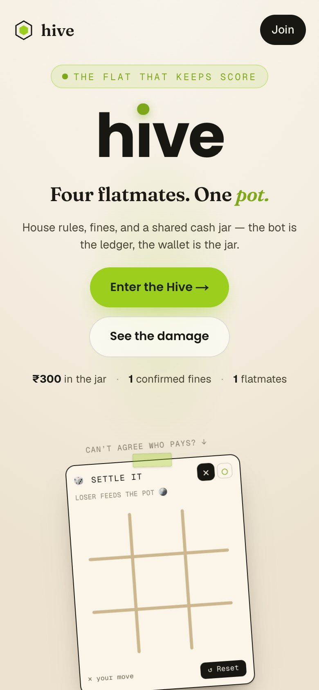
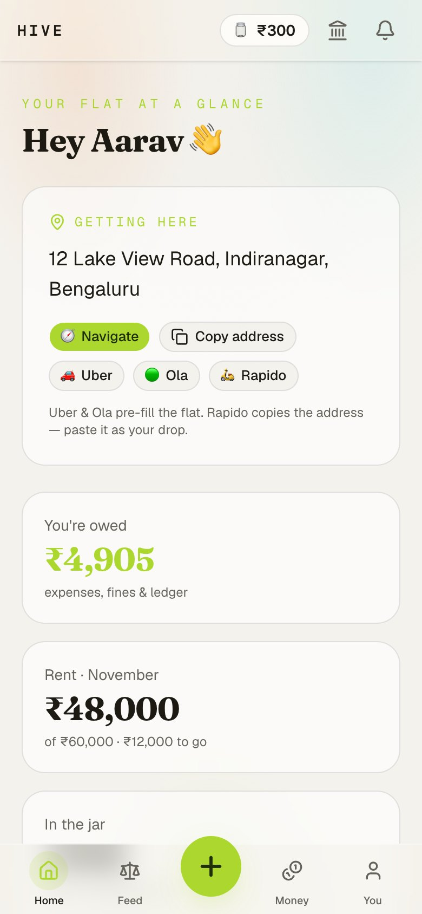
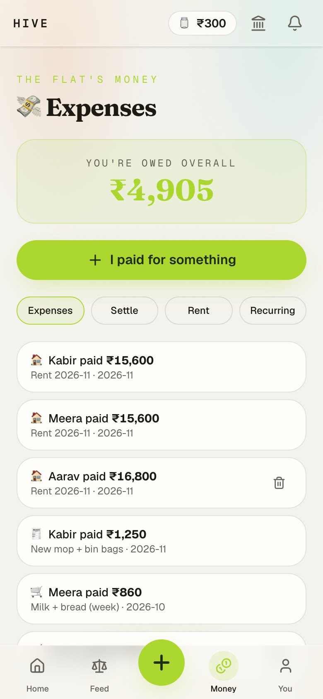
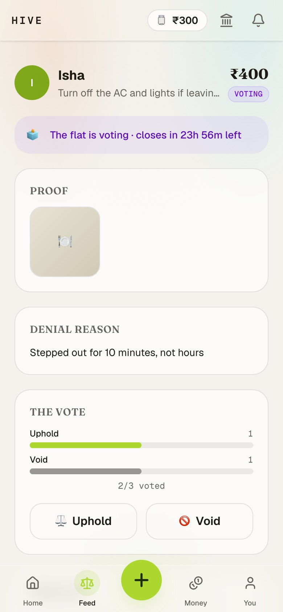
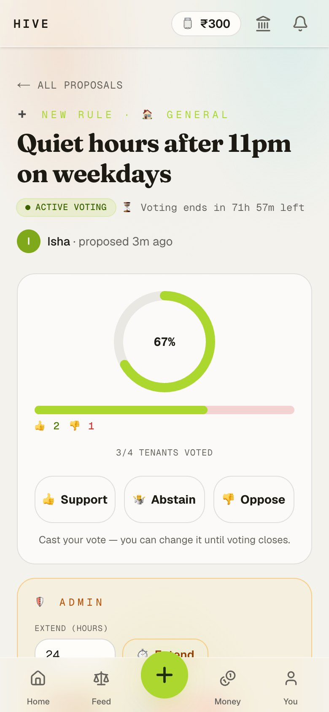
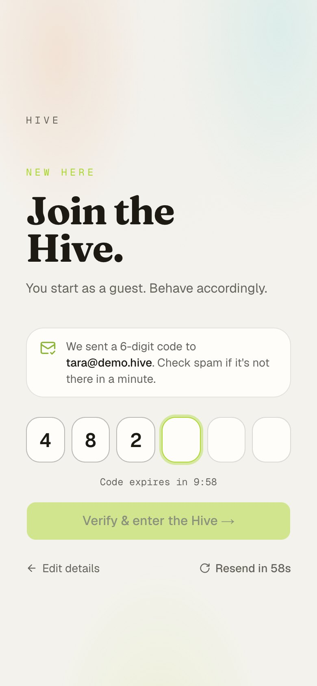

<div align="center">

# Hive

**The flat that keeps score.**

A mobile-first web app for shared flats: house rules, fines backed by photo proof,
flat votes on disputes, shared expenses, rent and settle-up.


**[Live app](https://hive-flat.duckdns.org)** · [Backend](https://github.com/vijayfagaria-dev/hive-api) · [Features](#features) · [Getting started](#getting-started)

</div>

<br>

| Landing | Dashboard | Shared expenses |
|---|---|---|
|  |  |  |

| Flat vote on a dispute | Rule change proposal | Sign-up verification |
|---|---|---|
|  |  |  |

## About

Hive gives a shared flat one place for everything that usually lives in group chats and
memory: the house rules, who broke them, who paid for what, and who owes whom. It is built
for phones first and installs to the home screen like a native app.

This repository is the web client. The API lives in
[hive-api](https://github.com/vijayfagaria-dev/hive-api).

## Features

- **Complaints with evidence:** report a rule break with a photo; disputes go to a flat vote
  with a live tally and countdown.
- **Expenses and settle-up:** split costs any way you like, track rent by tenant share, and
  settle the flat in the fewest payments.
- **UPI payments:** pay with one tap or a QR code from your own banking app.
- **Governance:** propose and vote on rule changes, with a versioned rule book.
- **Household:** invite flatmates, manage roles, and give guests a lighter view.
- **Notifications:** push on Android and iPhone, plus email and WhatsApp.
- **NFC stickers:** tap a sticker in the kitchen or on the balcony to see that spot's rules.

## Getting started

Requires Node.js 20+ and the [Hive API](https://github.com/vijayfagaria-dev/hive-api)
running locally.

```bash
git clone https://github.com/vijayfagaria-dev/hive-web.git
cd hive-web
npm install
npm run dev
```

Open `http://localhost:3000`. Requests to `/api` are forwarded to the backend on port 8000.

## Built with

- **Next.js 16** (App Router) and **React 19**, written in strict **TypeScript**
- **TanStack Query** for server state and **Zod** for a runtime-validated API contract
- **Tailwind CSS v4** with **shadcn/ui** on Base UI, and **Motion** for animation
- Installable **PWA** with Web Push
